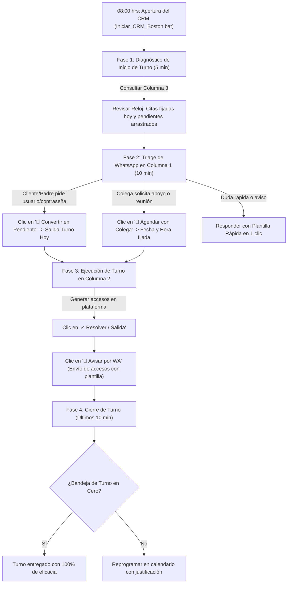

# Boston CRM Desk & WhatsApp Hub
## Centro de Gestión Operativa, Triage de Mensajes y Control de Turno
**Colegio Boston (Cuernavaca)**

---

### 1. ¿Cómo iniciar el programa?

Tienes dos formas inmediatas con **un solo clic**:
1. Haz doble clic en el archivo:
   `Iniciar_CRM_Boston.bat` (ubicado en la carpeta raíz de tu proyecto o dentro de `CRM_WhatsApp_Boston\`).
2. Se abrirá automáticamente una ventana de aplicación nativa (sin barras de navegador) en tu pantalla con el sistema activo en `http://localhost:3000`.

---

### 2. Estructura de las 3 Columnas

| Columna | Nombre | Función Principal |
| :--- | :--- | :--- |
| **Columna 1 (Izquierda)** | **Bandeja WhatsApp** | Recibe y organiza chats de padres, alumnos, docentes y dirección. Permite leer y responder mensajes, o **convertir cualquier mensaje en tarea/cita con un clic**. |
| **Columna 2 (Centro)** | **Pendientes del Turno** | Tu lista de control priorizada para el día (Turno Hoy). Muestra barra de avance, tiempos límites, filtros por contraseñas/apoyo a colegas y botones para **dar salida y avisar por WhatsApp**. |
| **Columna 3 (Derecha)** | **Agenda y Calendario** | Reloj con segundero en vivo, calendario mensual navegable con indicadores de días ocupados y la cronología/timeline de compromisos agendados. |

---

### 3. Flujo de Trabajo Operativo Diario (Metodología de Turno)

#### Paso a paso del flujo diario:

1. **Apertura matutina (08:00 hrs - 5 minutos):**
   - Inicia el CRM con el icono `Iniciar_CRM_Boston.bat`.
   - El sistema te muestra el **Reloj Digital en vivo**, el estado de tu turno y cuántos compromisos fijos tienes agendados para hoy en la **Columna 3**.

2. **Triage de WhatsApp (Columna 1 - 10 minutos):**
   - Revisa tus chats no leídos o el filtro `🔴 Con Pendientes`.
   - **Caso A: Cliente solicita usuario y contraseña:**
     - En el mensaje del padre o alumno, pulsa el botón `📌 Convertir en Pendiente`.
     - El sistema autodetecta que es de categoría *Contraseñas / Cuentas*, le asigna prioridad *Alta (Salida Inmediata en Turno)* y lo envía a la Columna 2.
   - **Caso B: Colega docente solicita apoyo para una actividad:**
     - En el mensaje del colega, pulsa `📅 Agendar con Colega`.
     - Fijas la fecha y hora convenida (ej. 12:30 hrs) y se anota de inmediato en la Agenda de la Columna 3.

3. **Ejecución y Despacho durante el Turno (Columna 2):**
   - Mantén abierta la vista `Para Hoy (Turno)`.
   - Conforme restableces accesos o realizas las tareas:
     - Pulsa `✓ Resolver / Salida`: la tarea se marca como cumplida y la barra de progreso avanza.
     - Pulsa `💬 Avisar por WA`: el CRM selecciona el chat del contacto y te redacta la plantilla de confirmación lista para enviar (ej. *"Estimado(a), tus accesos al portal escolar ya quedaron restablecidos..."*).

4. **Cierre de Turno y Salida (10 minutos antes de terminar):**
   - Verifica que el indicador de pendientes del turno esté en **0 pendientes**.
   - Si quedó alguna actividad externa pendiente para días posteriores, asegúrate de que esté registrada en la agenda del calendario para su seguimiento automático.

---

### 4. Características Técnicas
- **100% Autónomo y Local:** No requiere instalación de bases de datos pesadas ni software de terceros; utiliza almacenamiento seguro JSON atómico en `data/crm_store.json`.
- **Compatible con OneDrive:** El archivo de base de datos no bloquea la sincronización en la nube de tu cuenta institucional.
- **Modo Aplicación de Escritorio:** Se acopla en Microsoft Edge / Google Chrome como ventana nativa independiente sin pestañas ni barras estorbosas.
- **Acceso rápido a WhatsApp Web Oficial:** Cuenta con botón directo para sincronizar o abrir en paralelo con WhatsApp Web de navegador.
